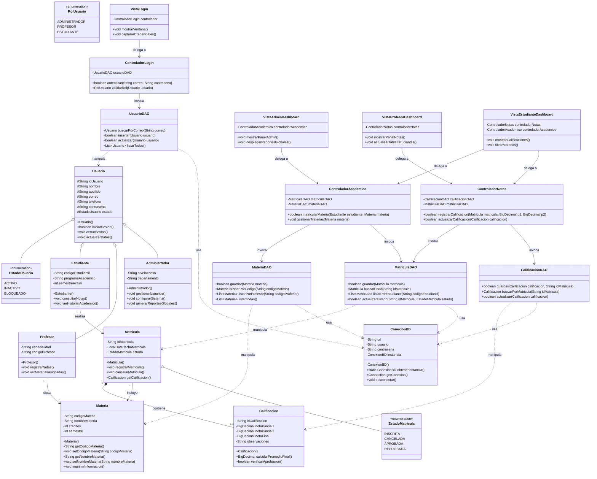

# Integrantes 
### William Villa
### Alejandro Ibarra
### Juan Pablo Rubiano
---

# Diagrama de clase Mermaid

# Aplicación para seguimiento académico (Academiall)

## 1. Planteamiento del problema

En diversos entornos educativos, la gestión del seguimiento académico que incluye la matrícula de estudiantes, la asignación de materias, el control de notas y la emisión de boletines suele realizarse de manera descentralizada o mediante herramientas ofimáticas aisladas. A través de las entrevistas realizadas a los interesados (administradores, docentes y estudiantes), se evidencia que la falta de un sistema de información integrado genera reprocesos en la digitación, dificulta el control de acceso a la información confidencial y retrasa la entrega oportuna de reportes de rendimiento académico.

---

## 2. Objetivos

### Objetivo General
Desarrollar una aplicación informática de seguimiento académico en Java aplicando el patrón de diseño MVC y conexión a una base de datos relacional, mediante el modelado de diagramas de actividades UML y la gestión de tablas de estudiantes, cursos y calificaciones, para automatizar el registro de información, el control de notas, la emisión de reportes y el control de acceso por roles (administrador, profesor y estudiante), reduciendo los tiempos de consolidación y garantizando la integridad de los datos.

### Objetivos Específicos
- Analizar e identificar los requerimientos funcionales y no funcionales del sistema mediante la recolección de información con los interesados para definir las responsabilidades y permisos asociados a los roles de administrador, profesor y estudiante.
- Implementar la aplicación en Java bajo el patrón MVC, integrando componentes de interfaz gráfica de usuario (GUI) y sentencias SQL para el control de acceso, el registro de notas y la generación de reportes.
- Validar el correcto funcionamiento de las operaciones CRUD, las reglas de negocio y los flujos de usuario mediante pruebas funcionales para asegurar la alineación del sistema con las necesidades del entorno educativo.

---

## 3. Requisitos Funcionales (RF)

### Módulo 1: Seguridad, Autenticación y Perfiles de Acceso (Integrante 1)

| Código | Requisito Funcional | Descripción Detallada | Actores |
| :--- | :--- | :--- | :--- |
| **RF-01** | Autenticación en el Sistema | El sistema debe permitir iniciar sesión ingresando un correo institucional y una contraseña válida. | Administrador, Profesor, Estudiante |
| **RF-02** | Validación de Estado del Usuario | El sistema debe restringir el acceso impidiendo el ingreso a usuarios cuyo estado sea BLOQUEADO o INACTIVO, notificando el motivo en pantalla. | Todos |
| **RF-03** | Enrutamiento Dinámico por Rol | Al autenticarse correctamente, el sistema debe redirigir de forma automática a la vista correspondiente según el rol (ADMINISTRADOR, PROFESOR, ESTUDIANTE). | Todos |
| **RF-04** | Gestión Global de Usuarios (CRUD) | El administrador debe poder crear, visualizar, listar y modificar los datos de los usuarios (nombres, apellidos, correo, teléfono, rol y estado). | Administrador |
| **RF-05** | Control de Estados de Usuario | El administrador debe poder cambiar el estado de un usuario entre ACTIVO, INACTIVO y BLOQUEADO. | Administrador |
| **RF-06** | Reportes Globales de Usuarios | El sistema debe generar y presentar resúmenes estadísticos con el total de usuarios clasificados por rol y por estado operativo. | Administrador |
| **RF-07** | Persistencia de Perfiles Específicos | Al registrar o editar usuarios, el sistema debe almacenar automáticamente los campos específicos según el tipo de entidad (nivel de acceso y departamento para administradores; código y especialidad para profesores; código, programa y semestre para estudiantes). | Administrador |

### Módulo 2: Gestión Académica, Materias y Matrículas (Integrante 2)

| Código | Requisito Funcional | Descripción Detallada | Actores |
| :--- | :--- | :--- | :--- |
| **RF-08** | Consulta de Oferta Académica | El sistema debe consultar y listar todas las materias activas registradas en la base de datos, indicando código, nombre, créditos y semestre. | Estudiante, Profesor, Administrador |
| **RF-09** | Inscripción y Matrícula de Asignaturas | El estudiante debe poder seleccionar una asignatura de la oferta académica y formalizar su matrícula en el sistema. | Estudiante |
| **RF-10** | Prevención de Matrículas Duplicadas | El sistema debe impedir que un estudiante inscriba una asignatura en la que ya posea una matrícula activa o en estado INSCRITA. | Estudiante, Sistema |
| **RF-11** | Registro Inicial de Matrícula | Toda nueva matrícula debe crearse con fecha de registro (`LocalDate.now()`) y asignarse con el estado inicial `INSCRITA`. | Sistema |
| **RF-12** | Consulta de Materias Inscritas | El estudiante debe poder visualizar su lista personal de materias matriculadas con sus respectivos estados académicos. | Estudiante |
| **RF-13** | Asignación Docente a Materias | El sistema debe permitir asociar cada materia a un docente específico mediante su identificador/código de profesor. | Administrador |
| **RF-14** | Cancelación de Matrícula | El sistema debe permitir la cancelación de una matrícula registrada, actualizando su estado a `CANCELADA`. | Estudiante, Administrador |

### Módulo 3: Calificaciones, Evaluaciones y Cierre Académico (Integrante 3)

| Código | Requisito Funcional | Descripción Detallada | Actores |
| :--- | :--- | :--- | :--- |
| **RF-15** | Listado de Estudiantes por Curso | El docente debe poder visualizar la lista de estudiantes inscritos en las asignaturas asignadas a su perfil. | Profesor |
| **RF-16** | Digitación de Notas Parciales | El docente debe poder ingresar y editar las notas del Parcial 1 (`notaParcial1`) y Parcial 2 (`notaParcial2`) para cada matrícula. | Profesor |
| **RF-17** | Validación de Rango de Notas | El sistema debe validar obligatoriamente que toda calificación ingresada se encuentre en el rango decimal de 0.0 a 5.0, rechazando valores fuera del intervalo. | Profesor, Sistema |
| **RF-18** | Cálculo Automático de Nota Final | El sistema debe calcular de manera automática el promedio o nota final a partir de los parciales registrados. | Sistema |
| **RF-19** | Determinación de Aprobación/Reprobación | Si la nota definitiva es $\ge 3.0$, la matrícula debe actualizarse a estado `APROBADA`; si es $< 3.0$, pasará a estado `REPROBADA`. | Sistema |
| **RF-20** | Observaciones Docentes | El profesor debe poder agregar anotaciones cualitativas u observaciones sobre el rendimiento del alumno en la materia. | Profesor |
| **RF-21** | Consulta de Historial y Boleta de Calificaciones | El estudiante debe poder consultar sus calificaciones parciales, nota final, observaciones y el estado definitivo de cada materia cursada. | Estudiante |

---

## 4. Requisitos No Funcionales (RNF)

### 4.1. Seguridad e Integridad

| Código | Requisito No Funcional | Descripción Detallada |
| :--- | :--- | :--- |
| **RNF-01** | Cifrado en Tránsito (SSL/TLS) | La conexión entre la aplicación y el clúster de Neon Tech debe realizarse mediante canal seguro con protocolo SSL (`sslmode=require`) y enlace obligatorio (`channel_binding=require`). |
| **RNF-02** | Protección de Credenciales | Los campos de entrada para contraseñas deben estar ocultos en la interfaz mediante componentes seguros (`JPasswordField`). |
| **RNF-03** | Prevención de Inyecciones SQL | Toda consulta y operación de persistencia debe implementarse estrictamente mediante `PreparedStatement` parametrizado. |
| **RNF-04** | Integridad Transaccional | Las operaciones que involucren múltiples tablas (por ejemplo: insertar usuario y su perfil en tabla hija) deben ejecutarse bajo transacciones ACID (`setAutoCommit(false)`, `commit()` y `rollback()`). |

### 4.2. Rendimiento y Concurrencia

| Código | Requisito No Funcional | Descripción Detallada |
| :--- | :--- | :--- |
| **RNF-05** | Tiempo de Respuesta de Autenticación | El proceso de validación de credenciales y carga de la vista correspondiente debe ejecutarse en menos de 2 segundos bajo condiciones normales de red. |
| **RNF-06** | Patrón Singleton para Conexiones | La gestión de conexiones JDBC a la base de datos debe centralizarse en una única instancia reutilizable mediante el patrón Singleton (`ConexionBD`). |

### 4.3. Arquitectura y Mantenibilidad

| Código | Requisito No Funcional | Descripción Detallada |
| :--- | :--- | :--- |
| **RNF-07** | Arquitectura en Capas (MVC + DAO) | El código debe estructurarse desacoplando la capa de presentación (`view`), controladores (`controller`), lógica de persistencia (`dao` e `impl`), utilidades (`util`) y modelo de dominio (`model`). |
| **RNF-08** | Principio de Inversión de Dependencias (SOLID) | Los controladores deben comunicarse con la capa de datos exclusivamente a través de interfaces Java (`IUsuarioDAO`, `IMateriaDAO`, `IMatriculaDAO`, `ICalificacionDAO`). |
| **RNF-09** | Precisión de Cálculos Numéricos | El registro y cálculo de calificaciones debe implementarse utilizando tipos exactos (`BigDecimal` en Java y `NUMERIC(4,2)` en PostgreSQL) para evitar pérdida de precisión de punto flotante. |
| **RNF-10** | Tipado Fuerte para Fechas | El almacenamiento y tratamiento de fechas de matrícula debe realizarse con la API de fecha moderna de Java (`java.time.LocalDate`) y tipos `DATE` de SQL. |

### 4.4. Usabilidad e Interfaz Gráfica

| Código | Requisito No Funcional | Descripción Detallada |
| :--- | :--- | :--- |
| **RNF-11** | Feedback Claro al Usuario | El sistema debe mostrar mensajes claros y no intrusivos ante errores de validación, campos vacíos o duplicación de llaves primarias sin pérdida de datos en formularios. |
| **RNF-12** | Compatibilidad Multiplataforma | La interfaz desarrollada con Java Swing debe ser compatible y renderizarse de forma homogénea en sistemas operativos Windows, macOS y Linux con Java 17+. |

### 4.5. Confiabilidad y Calidad de Pruebas

| Código | Requisito No Funcional | Descripción Detallada |
| :--- | :--- | :--- |
| **RNF-13** | Validación mediante Pruebas Unitarias | La lógica crítica de negocio (cálculo de notas, rangos, login, transiciones de estado) debe estar cubierta por suites de pruebas automáticas en JUnit 5. |
| **RNF-14** | Tolerancia a Fallos en Conexión | Si la base de datos no está disponible, el sistema debe capturar las excepciones SQL sin provocar el cierre abrupto (crash) de la aplicación de escritorio. |

---

## 5. Matriz de Trazabilidad: Requisitos vs Integrantes

| Módulo / Alcance | Requisitos Funcionales | Requisitos No Funcionales Clave | Responsable Asignado |
| :--- | :--- | :--- | :--- |
| Seguridad, Login y Administración | RF-01 al RF-07 | RNF-01, RNF-02, RNF-03, RNF-04, RNF-06, RNF-11 | Alejandro Ibarra |
| Académico, Materias y Matrículas | RF-08 al RF-14 | RNF-07, RNF-08, RNF-10, RNF-12 | William Villa |
| Docente, Calificaciones y Reportes | RF-15 al RF-21 | RNF-08, RNF-09, RNF-13, RNF-14 | Juan Pablo Rubiano |